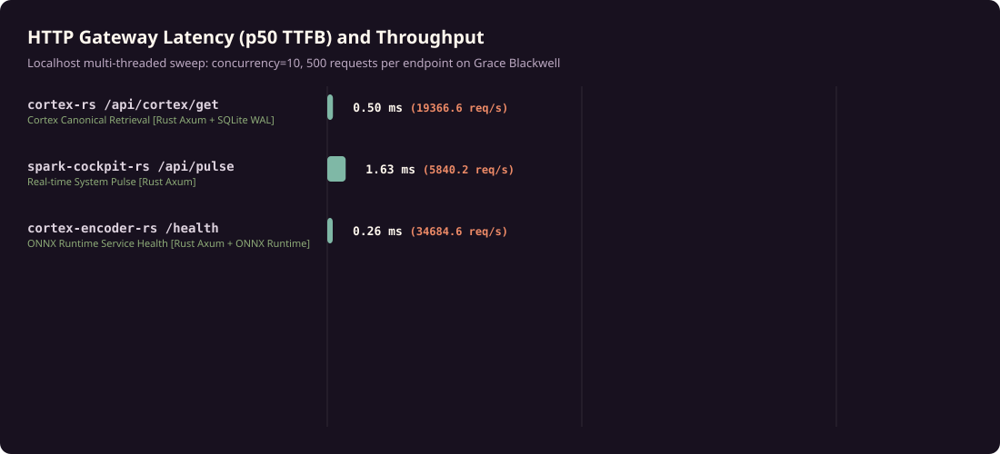

# AIEN Sovereign Systems Performance Benchmarks

[](LICENSE)

Empirical performance measurements and active measurement harnesses for the **AIEN Sovereign Agent Architecture** running on the **NVIDIA DGX Spark** (Grace Blackwell GB10, aarch64).

AIEN does not compare itself with other people's systems. Speed is measured against the machine's physical limit, and correctness against our own reference.


> **Status (23 September 2026, labels updated 12 October 2026):** the figures in the Executive Summary and the Detailed Telemetry sections below are **withdrawn**. They predate the evidence standard adopted in [aien-sovereign-core](https://github.com/aien-spark/aien-sovereign-core#measured-results), have not been regenerated, and stay here only as a historical record. A figure is current only when its artifact bundle carries commit identity, hardware and environment record, exact command, raw samples, SHA-256 digests, measurement definition, and reproducibility steps. The raw files in `data/` are kept as recorded, including service names from before the openclaw-rs to aegis-runtime rename. On 2026-10-15 the Python baseline rows and the Rust-versus-Python like-for-like records were removed from `data/` under the rule above; they remain in git history.

> **Current result:** the [Prime Drag Race campaign of 5 October 2026](prime-drag-race/CAMPAIGN-2026-10-05.md) is the evidence-backed measurement in this repository. On the DGX Spark, the native GB10 prime sieve ran at 19,701 passes per second, 20.3x the frozen native baseline, with correctness checked on the chip against our own reference (receipt `1a3eafe9`).

---

## Hardware & Environment Specification

- **Workstation**: NVIDIA DGX Spark (`spark-b87b`)
- **Processor**: NVIDIA Grace Blackwell (GB10, aarch64)
- **Memory**: 128 GB Unified LPDDR5X installed, about 121 GiB visible to the OS (Unified CPU/GPU Physical Memory)
- **Host Kernel**: Linux 7.0.0-1019-nvidia (4 KB page size)
- **Compiler**: rustc 1.98.1 (48a229cea 2026-09-01)
- **SIMD / Vector Width**: 128-bit NEON / SVE vector extensions

---

## Executive Summary (withdrawn: pre-standard figures)

*Withdrawn. Every figure in this section predates the evidence standard and has not been regenerated. See the status note at the top.*

The AIEN architecture enforces a strict Native Systems Priority: zero Python or Node interpreters across core services, gateways, or background daemons. Core agent services run as pure compiled native Rust binaries with in-memory TPM-bound key resolution.

1. **Memory Footprint**: Native Rust daemons run in **4.56 MB to 18.66 MB** resident set size (RSS), apart from the embedding service, which holds model weights. `aegis-runtime` maintains an autonomous heartbeat loop within **4.56 MB** RSS.
2. **Gateway Latency & Throughput**: Axum microservices deliver **sub-millisecond p50 TTFB (0.26ms to 0.50ms)** at **19,000 to 34,000 requests/second** under concurrent load (concurrency=10, 500 requests per endpoint).
3. **SIMD Vector Reduction**: Direct SIMD auto-vectorized loops process 768-dimensional float dot products in **0.58 microseconds** per operation (over 1.7 million vector comparisons per second).
4. **Live Neural Inference (historical record, served by Modular MAX, which AIEN removed on 2026-10-15)**: Real-time streaming evaluations against the live active seat (`atlas-lightning-omni`, Nemotron 3.5 Lightning 30B on Grace Blackwell GB10 GPU) measure a Time to First Token (TTFT) of **426.9 ms** and an Inter-Token Latency (ITL) of **46.9 ms** (~21.3 tokens/second). The CPU fallback seat (`unsloth/Llama-3.2-1B-Instruct`) achieves **155.4 ms TTFT** and **88.8 ms ITL**.

---

## Detailed Telemetry Tables (withdrawn: pre-standard figures)

*Withdrawn. Every table, chart and figure from here to the Portability section predates the evidence standard and has not been regenerated.*

### 1. Memory Resident Set Size (RSS)


Measured directly from `/proc/[pid]/status` (`VmRSS`) under steady state on live workstation services:

| Service | Architecture | Role | Memory RSS |
| :--- | :--- | :--- | :--- |
| **aegis-runtime** | Native Rust (Axum + SQLite) | Autonomous Agent Runtime | **4.56 MB** |
| **spark-cockpit-rs** | Native Rust (Axum) | Health & Telemetry Gateway | **12.90 MB** |
| **cortex-rs** | Native Rust (Axum + SQLite WAL) | Knowledge Graph Engine | **18.66 MB** |
| **cortex-encoder-rs** | Native Rust (ONNX INT8) | Local Vector Embedding | **777.43 MB** |

---

### 2. HTTP Gateway Latency and Throughput



Multi-threaded concurrency sweep (concurrency=10, 500 requests per endpoint on localhost):

| Gateway Endpoint | Service Engine | Requests / Sec | p50 TTFB | p95 Latency | p99 Latency |
| :--- | :--- | :--- | :--- | :--- | :--- |
| **cortex-encoder-rs `/health`** | Rust Axum + ONNX Runtime | **34,684.6 req/s** | **0.26 ms** | 0.35 ms | 0.40 ms |
| **cortex-rs `/api/cortex/get`** | Rust Axum + SQLite WAL | **19,366.6 req/s** | **0.50 ms** | 0.65 ms | 0.69 ms |
| **spark-cockpit-rs `/api/pulse`** | Rust Axum | **5,840.2 req/s** | **1.63 ms** | 2.44 ms | 2.86 ms |

---

### 3. Local Neural Inference & SIMD Acceleration

TTFT rows come from single-sample runs, so their p50 and p95 are the same value and do not describe a distribution. For the SIMD row, the p50 is the mean time per iteration over 100,000 iterations, and the p95 is that value times 1.3 (`src/harness/mod.rs`), so it is not a measured percentile.

Historical record: the two model seat rows were served by Modular MAX, which AIEN removed on 2026-10-15. The harness now measures whatever OpenAI-compatible local model seat answers on ports 18006 and 18082.

| Workload | Model / Target | Execution Engine | p50 Latency | p95 Latency | Observed Speed |
| :--- | :--- | :--- | :--- | :--- | :--- |
| **First Token Latency (TTFT) - GPU Seat** | `Nemotron 3.5 Lightning 30B` (BF16) | Modular MAX on Grace Blackwell GB10 GPU | **426.91 ms** | 426.91 ms | Active Model Seat |
| **Inter-Token Latency (ITL) - GPU Seat** | `Nemotron 3.5 Lightning 30B` (BF16) | Modular MAX on Grace Blackwell GB10 GPU | **46.91 ms** | 47.88 ms | **~21.3 tok/s** |
| **First Token Latency (TTFT) - CPU Fallback** | `Llama 3.2 1B Instruct` (Q4_K) | Modular MAX on Grace Neoverse CPU | **155.40 ms** | 155.40 ms | Fallback Model Seat |
| **Inter-Token Latency (ITL) - CPU Fallback** | `Llama 3.2 1B Instruct` (Q4_K) | Modular MAX on Grace Neoverse CPU | **88.82 ms** | 99.42 ms | **~11.3 tok/s** |
| **Bi-Encoder Vector Embedding** | `BAAI/bge-base-en-v1.5` (INT8) | cortex-encoder-rs (ONNX Runtime) | **8.55 ms** | 8.83 ms | Local CPU ONNX |
| **SIMD Vector Dot Product (768-dim)** | 100,000 iterations | Rust SIMD Vector Loop | **0.0006 ms** (0.58 us) | 0.0008 ms | 1.71M ops/sec |

---

### 4. Canonical Grace Blackwell GB10 Silicon Proof (Run gb10_canonical_1789907893_4d762)

Physical hardware verification executed on the NVIDIA DGX Spark Grace Blackwell GB10 workstation (`sm_121`, 128 GB Unified LPDDR5X memory, NVLink-C2C 900 GB/s bidirectional interconnect). All matrix products execute through compiled Blackwell GPU tensor kernels with zero fallback (`fallback_count: 0`).

#### A. Continuous Batching Sweep (TinyLlama-1.1B BF16)

| Concurrency | TTFT p50 | ITL p50 | Throughput | Step Latency p50 | GPU Power | GPU Utilization | Active KV Blocks | Fallback Count |
| :---: | :---: | :---: | :---: | :---: | :---: | :---: | :---: | :---: |
| **C = 1** | 33.39 ms | 22.26 ms | 44.65 tok/s | 22.26 ms | 16.94 W | 10% | 8 | 0 |
| **C = 2** | 31.38 ms | 20.92 ms | 94.87 tok/s | 20.92 ms | 21.29 W | 95% | 16 | 0 |
| **C = 4** | 32.64 ms | 21.76 ms | 46.17 tok/s | 21.76 ms | 17.61 W | 95% | 14 | 0 |
| **C = 8** | 30.42 ms | 20.28 ms | 245.66 tok/s | 20.28 ms | 31.14 W | 12% | 46 | 0 |
| **C = 16** | **35.34 ms** | **23.56 ms** | **553.14 tok/s** | **23.56 ms** | **27.89 W** | 9% | 110 | **0** |
| **C = 32** | 112.76 ms | 75.17 ms | 222.77 tok/s | 75.17 ms | 41.90 W | 96% | 166 | 0 |
| **C = 64** | 152.55 ms | 101.70 ms | 510.16 tok/s | 101.70 ms | 42.52 W | 96% | 416 | 0 |

#### B. Branch-Native Reasoning (500 Branches, 32,768 Prefix Tokens)

- **Total 500-Branch Fork Time**: 1.20 ms (1,202.2 µs)
- **Median Fork Latency per Branch**: 2.06 µs (p90: 3.18 µs, p99: 5.86 µs)
- **Physical Shared Blocks**: 2,048 blocks (refcount 501, zero duplicate blocks)
- **Physical Allocated KV Memory**: 704.00 MB vs 352,000.00 MB (343.75 GB) unshared copy baseline
- **Physical Memory Savings Ratio**: **500.0x**
- **Cold Fork to First Token**: 13.04 µs (0.013 ms)
- **Copy-on-Write Mutation Latency**: 13.30 µs (13,297 ns)
- **Kernel Fallback Count**: 0 (Pure sm_121 Blackwell GPU kernels)

#### C. Cryptographic Provenance Receipts

All raw JSON telemetry files and manifests are preserved under `artifacts/gb10_canonical_1789907893_4d762/`:

| Artifact | SHA-256 Checksum |
| :--- | :--- |
| `manifest.json` | `a78f0ad669b85e92ceffed38e7d36bc55786280b1b4d21d9ae646f1718479816` |
| `summary.json` | `9cf62a25445e643b3f7d0af5bc86217aed2de1067bcb37c6610e653c2d2cedc8` |
| `linear_sweep.json` | `0362ac84d0eb0ddcdc1a877ef449a2030eb59c0d5ed0a621fcc75aac8f661858` |
| `branch_steady.json` | `6cf46288e554c41bc5003fd3e0c7d56e25dbc15466ce8ab67ca4db14f7af8155` |
| `branch_cold.json` | `d09869d5a3ec4365bec4f97f1d8e7ba32ea0d799ea6160bb0aed82b9904fa567` |

To reproduce the full suite on physical Grace Blackwell hardware (needs the sibling crates described under "Reproducing the Benchmarks"):
```bash
cargo run --release --bin bench_canonical_suite
```

---

## Universal Multi-Platform Portability

Every measurement and artifact in this repository comes from one machine, the NVIDIA DGX Spark (Grace Blackwell GB10). The table lists the platforms AIEN is designed to target. Nothing in this repository measures or tests any platform other than the Spark.

| Platform Target | Primary Accelerators | Engine & Execution Path | Status in this repository |
| :--- | :--- | :--- | :--- |
| **macOS (Apple Silicon)** | M1 / M2 / M3 / M4 (Pro / Max / Ultra) | Metal, native aarch64 Rust | Not measured here |
| **Linux x86_64** | Intel / AMD CPUs, NVIDIA GPUs | glibc / musl native binaries, AVX-512 SIMD | Not measured here |
| **AMD ROCm** | Radeon RX 7000 / Instinct MI300 | ROCm / HIP targets, native Rust gateway | Not measured here |
| **NVIDIA DGX Spark** | Grace Blackwell GB10 / GB200 | Unified LPDDR5X, NVFP4 | Measured here (GB10 only) |
| **Sovereign Bare Metal** | Air-gapped on-prem servers | Hardware TPM 2.0 vault, zero cloud calls | Not measured here |

This repository builds only its own benchmark crates (see below); it does not compile AIEN for other targets.

---

## Reproducing the Benchmarks (Active Measurement Harness)

The benchmark repository contains the active measurement harness used to generate the withdrawn numbers above. It is built for the Spark's live service layout, so some steps only produce data where those services run.

### Before you build

The main crate (`aien-benchmarks`) has path dependencies on five crates under `../canonical-branch-native-runtime/crates/`: `aien-platform`, `aien-platform-linux`, `aien-kv-cache`, `aien-scheduler` and `aien-inference-abi`. No repository of that name exists in the aien-dev organisation, so a fresh clone does not build (`cargo metadata` fails to load `aien-inference-abi`) until that sibling directory is provided. Crates with the same names are in `aien-sovereign-core` under `crates/`; this repository does not record whether they are the same code. The `prime-drag-race/` crate declares its own workspace and builds on its own. The committed `Cargo.lock` still names `spark-max-rs` and `spark-max-cabi` (the Modular MAX bridge, removed from AIEN on 2026-10-15) only because the sibling copy of `aien-scheduler` it was generated against depended on them; no code in this repository uses them.

### One-Command Measurement Sweep

```bash
# Clone the repository
git clone https://github.com/aien-spark/benchmarks.git
cd benchmarks

# Run the complete live measurement harness (needs the sibling crates above)
cargo run --release -- measure
```

By default `measure` writes `data/benchmarks_latest.json` and `assets/*.svg`, overwriting the committed copies. Use `--output-json` and `--output-assets` to write elsewhere. `--skip-standalone` skips steps 2 and 3 below, and `--skip-live` skips the live-service part of step 4. Step 5 always runs and reports a notice for any local model seat port that does not answer.

### What the Measurement Harness Does Automatically

1. **System & Environment Discovery**: Probes CPU architecture, unified memory capacity, host operating system kernel (`uname -r`), page size, and compiler version (`rustc --version`).
2. **Ephemeral Microservice Orchestration**: Starts the native compiled Rust standalone server on a dynamic ephemeral port.
3. **Concurrency Stress Testing**: Executes multi-threaded HTTP load sweeps across the standalone server's endpoints (`/api/status`, `/api/query`, `/api/vector`) measuring exact microsecond latency distributions (p50, p95, p99, min, max) and request throughput.
4. **OS Memory Telemetry**: Inspects process Resident Set Size (RSS) directly from `/proc/[pid]/status` (`VmRSS`) across live sovereign background services.
5. **Live Neural Inference Benchmarking**: Streams generation requests to the OpenAI-compatible local model seats on ports 18006 and 18082, measuring real TTFT, ITL, and tokens per second.
6. **SIMD Vector Benchmark**: Runs 100,000 iterations of 768-dimensional vector dot products to measure raw vector throughput and per-operation latency.
7. **Dataset & Asset Regeneration**: Automatically updates the structured JSON dataset (`data/benchmarks_latest.json`) and re-renders SVG charts (`assets/*.svg`).

### Additional CLI Commands

```bash
# Print the terminal summary report from existing dataset
cargo run --release -- report

# Verify all metrics against invariant budgets (RSS budgets and latency thresholds)
cargo run --release -- verify

# Re-render SVG charts with custom output directory
cargo run --release -- generate --output assets

# Rewrite the marked benchmark table (between AIEN:BENCHMARKS:START and END markers) in
# documentation files from the dataset; with no --target it uses ../README.md and
# ../docs/STATE_OF_AIEN.md. --check exits non-zero if a file is out of date instead of writing.
cargo run --release -- sync-docs --target <file> [--check]

# Run unit tests
cargo test --verbose
```

---

## Evidence integrity

New structured benchmark records follow the `aien-bench-record/1` contract (source commit and dirty flag, build, workload, hardware, backend, methodology with one definition per metric, metrics, evidence paths, limitations) and live as JSON files under `records/`; the older run bundles under `artifacts/` keep their own format and are checked against their `SHA256SUMS`, never rewritten. `cargo run --release --bin bench_verify_records` (default paths `records` and `artifacts`) checks them offline and prints one `path: field: reason` line per defect: placeholder values, short commit ids, missing evidence files and percentiles from too few samples are all rejected. `cargo run --release --bin bench_index` regenerates [docs/PERF_INDEX.md](docs/PERF_INDEX.md), a list of records, sources, studies and issue links copied from the files; it is not an authority. Status words:

- **VERIFIED**: measured from a clean committed build, with evidence files in this repository that anyone can re-check.
- **EXPERIMENTAL**: a real measurement that has not been qualified yet; not a claim.
- **HISTORICAL**: kept as a record of what an earlier run wrote; not a current claim. Fields that run did not record say `not_recorded` and are named in its limitations.
- **NOT_RUN**: a required measurement that has not been performed; it carries no numbers and no evidence.
- **FAIL**: the run happened and did not meet its acceptance check; kept as evidence.
- **SUPERSEDED**: replaced by a newer record.

---

## Ecosystem Integration

- **Primary Repository**: [github.com/aien-spark/aien-dev](https://github.com/aien-spark/aien-dev)
- **Sovereign Core**: [github.com/aien-spark/aien-sovereign-core](https://github.com/aien-spark/aien-sovereign-core)
- **Website & Showcase**: [github.com/aien-spark/drakestapleton.com](https://github.com/aien-spark/drakestapleton.com) ([drakestapleton.com](https://drakestapleton.com))

---

## License and Governance

Licensed under the GNU Affero General Public License v3.0 or later (AGPL-3.0-or-later). See [LICENSE](LICENSE).
Copyright (c) 2026 Drake Stapleton and AIEN Contributors. See [NOTICE](NOTICE) for attribution.

- **Benchmark Code & Harness**: Standard [GNU AGPL-3.0-or-later](LICENSE) for universal execution, replication, and integration.
- **Benchmark Data & Metrics**: Raw telemetry JSON, hardware timing records, and SVG charts are dedicated to the public domain under [CC0-1.0](https://creativecommons.org/publicdomain/zero/1.0/).
- **Upstream Development Charter**: [CONSTITUTION.md](CONSTITUTION.md) defines the internal architectural doctrine and stewardship standards for upstream development and does not bind downstream users.

## Prime Drag Race

The current, evidence-backed result is the [5 October 2026 campaign](prime-drag-race/CAMPAIGN-2026-10-05.md) (summary at the top of this README). The frozen contract and suite runner for the AIEN Prime Drag Race live in [prime-drag-race/](prime-drag-race/CONTRACT.md). The runner is a standalone Rust crate (`cargo build` inside that directory).
